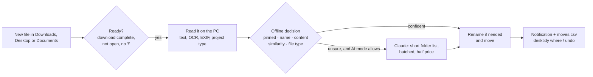

<p align="center">
  
</p>

<h1 align="center">DeskTidy</h1>

<p align="center">
  <b>Your files, sorted while you work.</b><br>
  DeskTidy watches Downloads, Desktop and Documents, understands what every new file is about,
  gives it a proper name and files it in the right folder. Offline first, with Claude AI only for the hard cases.
</p>

<p align="center">
  <a href="https://github.com/davide0707/desktidy/actions/workflows/ci.yml"></a>
  
  
  
  <a href="LICENSE"></a>
</p>

---

`scan0001.pdf` lands in Downloads. Two minutes later it is `Documents\Personal\Bills\Invoice_2231_Northwind_Energy.pdf`,
you get a notification, and `desktidy where invoice` tells you where it went and why. No cloud drive, no subscription:
it reads the file **on your PC**, and only when it really can't decide it asks Claude, for a fraction of a cent.

## Read me first: the house rules

DeskTidy moves files for you, so it plays by a few simple rules. The installer shows them and asks you to accept them
before anything is moved ([HOUSE_RULES.md](HOUSE_RULES.md)).

1. **A name starting with `!` is never touched.** `!draft.docx` or a folder called `!work in progress` stays exactly
   where it is. Remove the `!` to let DeskTidy handle it again.
2. **Pin at least 2 folders before it starts.** Pinned folders are the places you want things to go (e.g. `Study`,
   `Work`, `Recipes`). Until two are pinned DeskTidy only watches: `desktidy setup` walks you through it.
3. **It waits before acting.** Downloads after 2 minutes, Desktop and Documents after 10. Open files, unfinished
   downloads, Office lock files, hidden and system files are skipped.
4. **Nothing is lost.** Every move and rename is logged (`desktidy where`) and can be undone (`desktidy undo`).
   Identical duplicates go to the Recycle Bin, never deleted.
5. **Private stays private.** IDs, payslips, bills, CVs, photos and screenshots are never sent to the AI. The AI is
   optional, with a daily limit and a budget.
6. **You're in charge.** `desktidy pause 1h`, `desktidy stop`, `desktidy preview` (see what it would do).

## Highlights

- **Understands content, offline.** Text from PDF, Word, Excel, PowerPoint (old `.doc` too), LibreOffice, RTF, HTML,
  e-mails, notebooks and ebooks; the built-in **Windows OCR** for scans and pictures; photos (camera EXIF),
  screenshots, icons, source code pasted into a `.txt`, and project types inside folders and zip files
  (Python, web, STM32, KiCad, gerber, 3D printing...). Plurals, singulars and typos are handled: `calculs notes.txt`
  still goes to *Calculus*.
- **Smart renaming.** `scan0001.pdf`, `Document1.docx`, `download (3).pdf` or a name that has nothing to do with the
  content get a real name, taken from the document title. The original name is always logged and `desktidy undo`
  brings it back.
- **Pinned folders.** Create `Recipes` on your Desktop and DeskTidy asks *"Pin it?"*. From then on recipes go there:
  by name, by content, or because they look like the files you already put inside.
- **AI only when needed, and cheap.** Four levels: `off`, `limited`, `moderate`, `ai-only`. Requests are designed for
  cost: a short list of likely folders instead of the whole tree, several files per request, short excerpts, and the
  Batch API at half price. **Measured: ~5.7× cheaper than sending the folder tree with every file** (see below).
- **Always in control.** Pause, see where anything went, undo any move, preview what would happen. Everything from a
  Kali-style console or one-line commands.

## Quick start

1. Install [Python 3.10+](https://www.python.org/downloads/) (tick *Add python.exe to PATH*).
2. Download DeskTidy and run the installer:

   ```bat
   git clone https://github.com/davide0707/desktidy
   cd desktidy
   install.cmd
   ```

3. The setup starts by itself: read the house rules and pin at least 2 folders.
4. Open a **new** Command Prompt and type `desktidy`.
5. Adapt the destinations to your folders: `desktidy rules` (then `desktidy rules check`).
6. Optional, for the hard cases: `desktidy key` and paste a [Claude API key](https://platform.claude.com/settings/keys).

> Without an API key DeskTidy works fully offline. With one, a typical month of downloads costs cents.

<details>
<summary>Prefer pipx?</summary>

```bat
pipx install "desktidy[ai] @ git+https://github.com/davide0707/desktidy"
desktidy install
```
</details>

## How it decides



1. **Pinned folders**: the name or the content talks about a folder you pinned.
2. **Name**: rule words, also in plural/singular form or with one typo.
3. **Content**: strong words (`content_words`), topics (`topics`, at least 2-3 must appear) and recognised kinds
   (`recognize`: `photo`, `screenshot`, `code_python`, `project_kicad`...). A *generic* rule such as "notes" gives way
   to a confident content match.
4. **Similarity** with the files already in each folder.
5. **File type** (`.stl`, `.py`, `.exe`...). Programs only ever go to the installers folder.

Run `desktidy explain <file>` to see exactly what DeskTidy understood and why it chose a folder.

## Smart renaming

| Before | After | Why |
|---|---|---|
| `scan0001.pdf` | `Invoice_2231_from_Northwind_Energy.pdf` | generic name, title from the first heading |
| `Document1.docx` | `Lab_report_RC_filters.docx` | generic name, title from the document properties |
| `holiday_photos_list.txt` (an electricity bill) | `Electricity_bill_September.txt` | the name didn't match the content |
| `download (3).pdf` (no clear title) | `RC_Circuit_Resistance_Measurement.pdf` | name suggested by Claude in the same request |
| `!draft.docx`, `IMG_2034.jpg`, `my_thesis.pdf` | unchanged | `!` means hands off; photos and good names are kept |

`desktidy rename smart | generic | off` chooses how bold it is.

## AI: cost and privacy

DeskTidy uses Claude only for the files the offline engine can't place (or places with low confidence, in `moderate`
mode). Everything is designed to spend as little as possible:

| What | Effect |
|---|---|
| Short list of likely folders per file (offline candidates, similar folders, pinned, top areas) | the folder tree was ~80% of the tokens |
| Up to 8 files share one request | instructions and folders paid once |
| ~1,200-character excerpt + key terms, from the text already read on the PC (OCR included) | the file itself is never uploaded |
| Images only when there is no text, downscaled to 512 px | ~260 tokens per image |
| Compact JSON answer with one-letter keys; a name is requested only when needed | few output tokens |
| **Batch API** by default | **half price** (answers usually within minutes) |

Measured with Anthropic's token counter on the same three files, against the previous design (whole folder tree in
every request): **1,292 → 371 input tokens per file**, plus the 50% batch discount: **~$0.0015 → ~$0.00026 per file
with Claude Haiku 4.5**.

Built-in brakes: a daily file limit, a total budget, an estimated credit (`desktidy spend credit 4.85`), and an
automatic pause when Anthropic reports the credit is exhausted. `desktidy spend` shows today, the last 7 days, the
month and the total.

> Anthropic does not let API keys read the prepaid balance, so DeskTidy computes the spend from the token counts
> returned with every answer, and estimates the remaining credit from the balance you type in.

**Never sent**: files matched by a `private` rule, photos, screenshots, programs. **Sent for the others**: the excerpt
above, the file name and the short folder list. The API key is stored in your Windows user environment, never in a file.

## Commands

Type `desktidy` for the console (use the number or the name), or `desktidy <command>` from any Command Prompt.

| Command | What it does |
|---|---|
| `setup` · `guide` | first-run setup (house rules + pinned folders) · show the house rules |
| `status` | running or stopped, pause, autostart, AI mode and key, spend, latest moves |
| `pause [30m · 2h · 1h30m · 1d · 18:30]` / `resume` | pause for a while, or until you resume |
| `start` / `stop` / `stop forever` / `restart` | `stop` stops now and starts again at the next sign-in |
| `autostart on · off` | start at sign-in |
| `where [name] [--open · --all]` | where did a file go, and why |
| `undo [name · number]` | put a file back where it was, with its old name |
| `pinned` · `pin <folder> [words]` · `unpin <folder>` · `pinned suggest` | pinned folders |
| `explain <file> [--ai]` | what DeskTidy understands of a file and where it would put it |
| `preview [--now] [--ai]` | what it would do right now, moving nothing |
| `rename smart · generic · off` | how bold renaming is |
| `spend` · `spend credit <usd>` · `spend budget <usd>` · `spend web` | AI spend, balance, budget |
| `ai off · limited · moderate · ai-only` · `ai max <n>` · `ai model haiku` · `ai delivery batch · instant` | how much AI |
| `key` · `key test` · `key remove` | Claude API key (hidden while you paste it, checked for free) |
| `log [errors · 100 · open]` · `rules [check]` · `open` | log, settings, data folder |
| `install` · `uninstall` · `about` | command and autostart, version |

## Configuration

Settings live in `%LOCALAPPDATA%\DeskTidy\rules.json` (created from [`default_rules.json`](desktidy/default_rules.json)
on the first run) and reload by themselves.

```jsonc
{
  "variables": { "DOCS": "%USERPROFILE%\\Documents", "INSTALLERS": "%USERPROFILE%\\Documents\\05_Software\\Installers" },
  "watched_folders": [ { "path": "{HOME}\\Downloads", "wait_seconds": 120, "include_folders": true } ],
  "default_destination": "{DOCS}\\00_Inbox\\To_Sort",
  "rename": { "mode": "smart" },
  "pinned_folders": { "min_required": 2, "ask": true, "ask_for_new_folders_in": ["{HOME}\\Desktop"] },
  "ai": { "mode": "limited", "model": "claude-haiku-4-5", "delivery": "batch", "budget_usd": 5.0,
          "user_context": "engineering student; electronics and web projects" },
  "rules": [
    {
      "name": "Study: maths",
      "name_words": ["calculus", "linear algebra"],            // in the file name
      "content_words": ["calculus"],                           // strong: one is enough
      "topics": ["derivative", "integral", "limit", "matrix"], // at least min_topics must appear
      "recognize": [],                                         // photo, screenshot, code_python, project_kicad...
      "destination": "{DOCS}\\01_Study\\Courses\\Maths",
      "private": false,                                        // true = never sent to the AI
      "generic": false                                         // true = a confident content match wins over the name
    }
  ]
}
```

Keywords work in any language; the bundled rules include English and Italian ones.

## Your data

Everything DeskTidy writes stays on your PC, in `%LOCALAPPDATA%\DeskTidy` (`desktidy open`):
`rules.json`, `moves.csv` (every move and rename, opens in Excel), `desktidy.log`, `ai_usage.json`, `pinned.json`.
None of it lives in the program folder, so updating DeskTidy never touches it. `desktidy uninstall` removes the
autostart and the command and leaves your files alone.

## FAQ

**Will it touch files I'm working on?** No. It waits until a download is complete and the file has been still for a
while, skips open files, Office lock files, hidden and system files, and anything whose name starts with `!`.

**What if it gets one wrong?** `desktidy undo <name>` restores it, with its original name, and DeskTidy leaves it alone
from then on.

**Does it need the internet?** No. The AI is optional and only used for the files the offline engine can't place.

**macOS or Linux?** Not yet: it relies on Windows OCR, Task Scheduler and notifications. Contributions are welcome.

## Development

```bat
python -m venv .venv
.venv\Scripts\pip install -e ".[ai,dev]"
.venv\Scripts\python -m unittest discover -s tests -t .
.venv\Scripts\ruff check .
.venv\Scripts\desktidy-service --dry-run --now
```

The tests run in temporary folders: they never move your files or touch your logs, and never call the AI.

```
desktidy/
  cli.py          console, commands, setup      service.py      background loop, moves, AI batches
  classifier.py   offline decision engine       content.py      text, OCR, EXIF, code and project detection
  naming.py       smart renaming                folders.py      folder catalog, similarity, pinned folders
  ai.py           compact Claude requests       usage.py        spend, budget, credit
  config.py       settings and data files       winapi.py       Task Scheduler, notifications, Recycle Bin
```

## Roadmap

- System tray icon with pause and recent moves
- Watch any folder, not just Downloads / Desktop / Documents
- Learn new rules from your `undo` corrections
- macOS and Linux support
- PyPI release

Ideas and pull requests are welcome: see [CONTRIBUTING.md](CONTRIBUTING.md).

## License

[MIT](LICENSE) © 2026 Di Filippo Davide

If DeskTidy saves you some clicks, a ⭐ helps other people find it.
