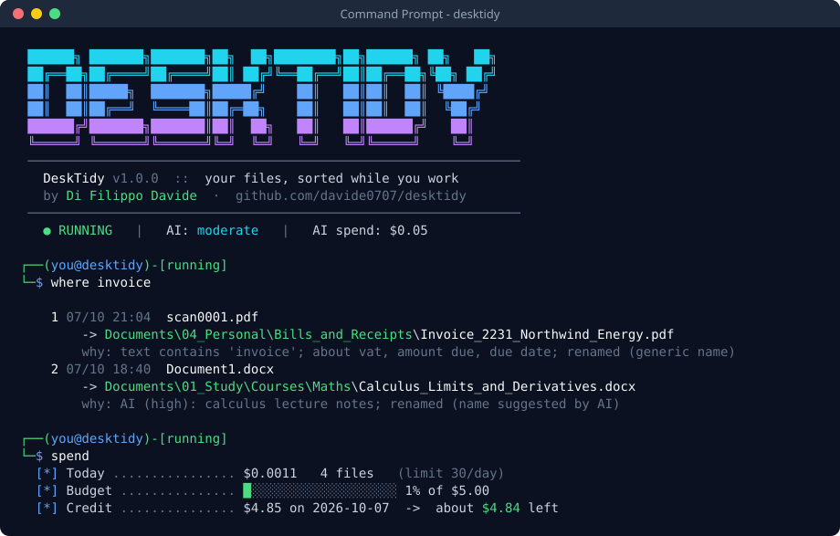
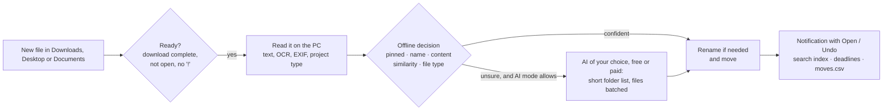

<p align="center">
  
</p>

<h1 align="center">DeskTidy</h1>

<p align="center">
  <b>Your files, sorted while you work.</b><br>
  DeskTidy watches Downloads, Desktop and Documents, understands what every new file is about,
  gives it a proper name and files it in the right folder. Offline first, with an AI of your choice (free ones included) only for the hard cases.
</p>

<p align="center">
  <a href="https://github.com/davide0707/desktidy/actions/workflows/ci.yml"></a>
  
  
  
  <a href="LICENSE"></a>
</p>

---

`scan0001.pdf` lands in Downloads. Two minutes later it is `Documents\Personal\Bills\Invoice_2231_Northwind_Energy.pdf`,
you get a notification with **Open** and **Undo** buttons, a reminder is set for the day before the bill is due, and
`desktidy find electricity september` finds it by what it says. No cloud drive, no subscription: it reads the file
**on your PC**, and only when it really can't decide it asks an AI: a free one (Groq, Gemini, Mistral, OpenRouter, or
Ollama on your own PC) or Claude / OpenAI for a fraction of a cent.

## Read me first: the house rules

DeskTidy moves files for you, so it plays by a few simple rules. The installer shows them and asks you to accept them
before anything is moved ([HOUSE_RULES.md](HOUSE_RULES.md)).

1. **A name starting with `!` is never touched.** `!draft.docx` or a folder called `!work in progress` stays exactly
   where it is. Remove the `!` to let DeskTidy handle it again (right-click → DeskTidy → *Hands off* does both).
2. **Pin at least 2 folders before it starts.** Pinned folders are the places you want things to go (e.g. `Study`,
   `Work`, `Recipes`). Until two are pinned DeskTidy only watches: `desktidy setup` walks you through it.
3. **It waits before acting.** Downloads after 2 minutes, Desktop and Documents after 10. Open files, unfinished
   downloads, Office lock files, hidden and system files are skipped.
4. **Nothing is lost.** Every move and rename is logged (`desktidy where`) and can be undone (`desktidy undo`).
   Identical duplicates go to the Recycle Bin, never deleted.
5. **Private stays private.** IDs, payslips, bills, CVs, photos and screenshots are never sent to the AI. The AI is
   optional, with a daily limit and a budget.
6. **You're in charge.** `desktidy pause 1h`, `desktidy stop`, `desktidy preview` (see what it would do),
   `desktidy limit 30` (at most 30 files a day).

## Highlights

- **Understands content, offline.** Text from PDF, Word, Excel, PowerPoint (old `.doc` too), LibreOffice, RTF, HTML,
  e-mails, notebooks and ebooks; the built-in **Windows OCR** for scans and pictures; photos (camera EXIF),
  screenshots, icons, source code pasted into a `.txt`, and project types inside folders and zip files
  (Python, web, STM32, KiCad, gerber, 3D printing...). Plurals, singulars and typos are handled.
- **Smart renaming.** `scan0001.pdf`, `Document1.docx` or a name that has nothing to do with the content get a real
  name, from the document title or from the AI in the same request.
- **Find anything by what it says.** `desktidy find bolletta luce settembre`: a local full-text index of every tidied
  document, OCR text included. Accents, plurals and singulars don't matter.
- **Deadlines.** "Pay by 30/10/2026", "scadenza 15 novembre", "due date October 30": found in bills and forms,
  amount included, with reminders 7 days, 1 day and on the day.
- **It learns.** Move a file DeskTidy misplaced and it notices; two similar corrections become a proposed rule.
- **Tidy-up tools.** The *To_Sort* pile grouped into folders, old versions of a document set aside, installers of
  programs you already installed found (GBs back), an automatic archive for what lies untouched for months, photos
  imported from memory cards sorted by date.
- **Advice on how to organise.** Once DeskTidy has an overview of your files, the AI suggests better ways to organise
  them, and `desktidy advice apply 2` does it for you after a preview (and `advice undo` reverts it).
- **Part of Windows.** Right-click menu in Explorer, notifications with buttons, an icon next to the clock, and all the
  settings in a page of your browser (`desktidy editor`).
- **Any AI, free ones included.** **Groq, Google Gemini, Mistral, OpenRouter** (free plans), **Ollama** (free, on your
  PC), **Claude** or **OpenAI** (paid), or any OpenAI-compatible server. Four levels: `off`, `limited`, `moderate`,
  `ai-only`. Daily limits you choose, or unlimited.
- **Cheap by design.** A short list of likely folders instead of the whole tree, several files per request, short
  excerpts, and Claude's Batch API at half price. **Measured: ~5.7× cheaper than sending the folder tree with every
  file** (see below).

## Quick start

1. Install [Python 3.10+](https://www.python.org/downloads/) (tick *Add python.exe to PATH*).
2. Install DeskTidy:

   ```bat
   pipx install "desktidy[ai]"
   desktidy install
   ```

   <details><summary>Without pipx, or from the source</summary>

   ```bat
   git clone https://github.com/davide0707/desktidy
   cd desktidy
   install.cmd
   ```
   </details>

3. The setup starts by itself: read the house rules, pin at least 2 folders, choose a daily limit (or unlimited).
4. Open a **new** Command Prompt and type `desktidy`, or right-click the DeskTidy icon next to the clock.
5. Adapt the destinations to your folders: `desktidy editor` (or `desktidy rules` for the JSON file).
6. Optional, for the hard cases: `desktidy ai provider` to pick an AI service (free ones included), then `desktidy key`.

> Without an AI DeskTidy works fully offline. With a free plan it costs nothing; with Claude a month of downloads
> costs cents. `desktidy update` keeps it up to date.

## How it decides



1. **Pinned folders**: the name or the content talks about a folder you pinned.
2. **Name**: rule words, also in plural/singular form or with one typo.
3. **Content**: strong words (`content_words`), topics (`topics`, at least 2-3 must appear) and recognised kinds
   (`recognize`: `photo`, `screenshot`, `code_python`, `project_kicad`...). A *generic* rule such as "notes" gives way
   to a confident content match.
4. **Similarity** with the files already in each folder.
5. **File type** (`.stl`, `.py`, `.exe`...). Programs only ever go to the installers folder.

Run `desktidy explain <file>` (or right-click → DeskTidy → *Explain*) to see exactly what DeskTidy understood and why.

## Smart renaming

| Before | After | Why |
|---|---|---|
| `scan0001.pdf` | `Invoice_2231_from_Northwind_Energy.pdf` | generic name, title from the first heading |
| `Document1.docx` | `Lab_report_RC_filters.docx` | generic name, title from the document properties |
| `holiday_photos_list.txt` (an electricity bill) | `Electricity_bill_September.txt` | the name didn't match the content |
| `Report_final.pdf` (a shopping list, no title) | `Weekly_shopping_list.pdf` | the AI found the name didn't match the content |
| `download (3).pdf` (no clear title) | `RC_Circuit_Resistance_Measurement.pdf` | name suggested by the AI in the same request |
| `!draft.docx`, `IMG_2034.jpg`, `my_thesis.pdf` | unchanged | `!` means hands off; photos and good names are kept |

`desktidy rename smart | generic | off` chooses how bold it is. In `smart` mode, every file the AI looks at also gets
its name checked: the AI keeps your name when it fits (even loosely) and replaces it only when it is misleading or
says nothing. Names that clearly match the content are never sent for checking, and an AI name must be meaningful
and really different to replace yours.

## Find, remember, remind

**Search by content.** Every document DeskTidy tidies goes into a local full-text index (SQLite FTS5, part of Python):
name, title, a one-line summary, key terms and up to 20,000 characters of text, OCR included. Documents already in
your folders are indexed in the background once a day (`desktidy find --rebuild` does it now).

```text
> desktidy find bolletta luce settembre
   1) Bolletta_Energia_Nord_Settembre.pdf  Documents\04_Personal\Bills
      Electricity bill for September, Energia Nord
      ...Totale da pagare 84,20 euro, da pagare entro il 30/10/2026...
```

**Deadlines.** Dates to pay or submit something are found in Italian and English documents ("da pagare entro il",
"scadenza", "entro e non oltre", "due date", "pay by", "expires on"...), with the amount when there is one. The AI
adds the date only when it reads the file anyway and the patterns found none. Reminders arrive 7 days, 1 day and on
the day (`deadlines.remind_days`), with *Open* and *Done* buttons. `desktidy deadlines` lists them; `deadlines add
2026-10-30 Pay the rent` adds one by hand.

**Learning from corrections.** Every 30 minutes DeskTidy checks whether you moved a file it had placed. Two corrections
towards the same folder with words in common become a proposed rule (`desktidy learn`, then `learn accept 1`): it is
added at the top of your rules, so it wins from then on.

## Tidy-up tools

| Command | What it does |
|---|---|
| `desktidy groups` | finds groups of related files in the *To_Sort* pile ("4 files about nucleo, gpio") and proposes an existing folder that looks like them, or a new one; `groups apply 1 --pin` moves them and pins the folder |
| `desktidy versions [folder]` | `Report.docx`, `Report_v2.docx`, `Report_final.docx`, `Report (1).docx`: the newest stays, the others go into `_old_versions` (`versions apply all`). Same name but different content (`Lesson_1`, `Lesson_2`) is never taken for a version |
| `desktidy installers` | setup files of programs that are already installed, compared by product name and version with Windows "Installed apps"; newer installers and recent downloads are kept. `installers clean` sends them to the Recycle Bin after you confirm |
| `desktidy archive` | items untouched for 180 days on the Desktop and in *To_Sort* go to `Archive\<year>`, optionally zipped. Off by default: `archive on` |
| `desktidy import` | a memory card or USB stick with a `DCIM` folder: new photos and videos are **copied** (the card is untouched) to `Pictures\2026\2026-10` by the date they were taken. The service offers it with a notification when you plug the card in |

Every move made by these tools is logged and can be undone with `desktidy undo`.

## AI: free or paid, your choice

DeskTidy asks an AI only about the files the offline engine can't place (or places with low confidence, in `moderate`
mode; every file in `ai-only`). Choose the service with `desktidy ai provider <name>`, then `desktidy key`:

| Service | Cost | Privacy | Reads images | Default model |
|---|---|---|---|---|
| `groq` *(default)* | **free** plan, about 1,000 requests a day, no card | prompts not used for training | no (text and OCR only) | `openai/gpt-oss-20b` |
| `gemini` | **free** tier on the Flash and Flash-Lite models | free tier: Google may use prompts to improve its products | yes | `gemini-3.5-flash-lite` |
| `mistral` | **free** Experiment plan (phone verification) | free plan: prompts may be used for training | yes | `mistral-small-latest` |
| `openrouter` | **free** `:free` models, 50 requests a day | free models: the host may log prompts | depends on the model | `google/gemma-4-31b-it:free` |
| `ollama` | **free**, runs on your PC ([ollama.com](https://ollama.com/download)) | nothing leaves your PC | yes | `gemma3:4b` |
| `claude` | paid, ~$0.0003 per file with the Batch API | not used for training | yes | `claude-haiku-4-5` |
| `openai` | paid | not used for training by default | yes | `gpt-5-nano` |
| `custom` | any OpenAI-compatible server (LM Studio, vLLM...) | your server | set `ai.vision` | set `ai.model` |

Free plans and model names change often (checked in October 2026): `desktidy ai model <id>` switches model, and
`desktidy key test` checks key and service for free. If a service refuses a feature (for example strict JSON),
DeskTidy steps down to a simpler request by itself and remembers it.

### Daily limits

| Limit | Default | Change it |
|---|---|---|
| Files DeskTidy tidies per day, AI or not | unlimited | `desktidy limit 30` · `desktidy limit unlimited` |
| Files the AI looks at per day | 10 / 30 / 100 by mode | `desktidy ai max 50` · `ai max unlimited` · `ai max auto` |

When a limit is reached, the other files simply wait for the next day (one notification tells you). The AI budget
(`desktidy spend budget <usd>`) applies even with an unlimited AI limit.

### Spending as little as possible

Every request is designed to be small, whatever the service:

| What | Effect |
|---|---|
| Short list of likely folders per file (offline candidates, similar folders, pinned, top areas) | the folder tree was ~80% of the tokens |
| Up to 8 files share one request, and files arriving close together wait up to 90 s for each other | instructions and folders paid once, fewer requests on free plans |
| Name check only for names the offline engine can't match with the content | no tokens spent on good names |
| ~1,200-character excerpt + key terms, from the text already read on the PC (OCR included) | the file itself is never uploaded |
| Images only when there is no text, downscaled to 512 px (never to text-only services) | ~260 tokens per image |
| Compact JSON answer with one-letter keys; summary and deadline in the same row | one request does it all |
| **Batch API** by default with Claude | **half price** (answers usually within minutes) |

Measured with Anthropic's token counter on the same three files, against the previous design (whole folder tree in
every request): **1,292 → 371 input tokens per file**, plus the 50% batch discount: **~$0.0015 → ~$0.00026 per file
with Claude Haiku 4.5**.

Built-in brakes: the daily limits, a total budget, an estimated credit (`desktidy spend credit 4.85`), and an
automatic pause when the service reports the credit is exhausted. `desktidy spend` shows today, the last 7 days, the
month and the total.

**Never sent**: files matched by a `private` rule, photos, screenshots, programs. **Sent for the others**: the excerpt
above, the file name and the short folder list. API keys are stored in your Windows user environment
(`GROQ_API_KEY`, `GEMINI_API_KEY`, `ANTHROPIC_API_KEY`...), never in a file.

### Advice on how to organise

In `ai-only` mode, once DeskTidy has tidied enough files to have an overview (30 by default), it asks the AI how your
files and folders could be organised better, about once a week, and tells you with a notification. `desktidy advice`
shows the ideas (merge, split, rename, move, archive, create or pin a folder, a naming convention), each with the
folders involved. `desktidy advice new` asks right away in any AI mode.

`desktidy advice apply 2` shows exactly what would happen (every move, step by step) and does it only after you
confirm: files are never deleted (a name already taken becomes `name_v2`), the rules, pinned folders, search index and
deadlines that pointed into a moved folder follow it, drive roots, watched folders and DeskTidy's own data are
refused, and if any step fails everything done so far is rolled back. `desktidy advice undo` reverts the latest one.

One small request (~2,000 tokens for 100 folders): folder names, how many files each holds and of which types, the
year of the latest change, two file names per folder (none from private folders), and what DeskTidy saw recently.
Never the content of a file. Even without an AI, `desktidy advice` lists what it finds offline.

## Part of Windows

- **Right-click menu** (`desktidy explorer on`, done by `desktidy install`): on files *Tidy now*, *Explain*, *Hands off*
  (adds or removes the `!`); on folders *Pin / unpin*, *Explain*, *Old versions here*, *Hands off*. On Windows 11 it is
  under *Show more options*, like every classic menu entry. Current user only, no administrator rights.
- **Notifications with buttons**: *Open* and *Undo* after a move, *Done* on a deadline, *Import* for a memory card,
  *Review* for a learned rule. They go through the `desktidy:` link, which accepts only a fixed list of actions with
  ids checked against DeskTidy's own records.
- **Tray icon** next to the clock: what DeskTidy did today, the latest moves, upcoming deadlines, advice, search,
  pause for an hour or until tomorrow, settings. `"tray": false` in rules.json turns it off.
- **Settings in the browser** (`desktidy editor`): rules, AI, limits, folders, variables, deadlines, archive and import
  in a page, with validation before saving and the previous file kept as `rules.json.bak`. It runs on `127.0.0.1`
  only, with a random token, while the command runs.

## Commands

Type `desktidy` for the console (use the number or the name), or `desktidy <command>` from any Command Prompt.

| Command | What it does |
|---|---|
| `setup` · `guide` | first-run setup (house rules, pinned folders, daily limit) · show the house rules |
| `status` | running or stopped, pause, limits, AI, deadlines, search index, latest moves |
| `pause [30m · 2h · 1h30m · 1d · 18:30]` / `resume` | pause for a while, or until you resume |
| `start` / `stop` / `stop forever` / `restart` · `autostart on · off` | the background service |
| `limit [n · unlimited]` | files tidied per day at most |
| `where [name] [--open · --all]` · `undo [name · number · #id]` | where did a file go, and why · put it back |
| `find <words> [--open]` · `find --rebuild [--ocr]` | search by content · rebuild the index |
| `pinned` · `pin <folder> [words]` · `unpin <folder>` · `pinned suggest` | pinned folders |
| `explain <file> [--ai]` · `preview [--now] [--ai]` · `tidy <file>` | understand a file · dry run · tidy one file now |
| `rename smart · generic · off` | how bold renaming is |
| `deadlines` · `deadlines done · open · remove <n>` · `deadlines add <date> <what>` | bills and deadlines |
| `groups [apply <n> --pin]` · `versions [apply <n> · all]` | the to-sort pile · old versions |
| `installers [clean]` · `archive [on · off · now · after <days> · zip on]` · `import [E:] · import auto on` | free space · archive · photos |
| `learn [accept · reject <n>]` | rules learned from your corrections |
| `ai off · limited · moderate · ai-only` · `ai max <n · unlimited · auto>` · `ai provider` · `ai model <id>` | how much AI, which service and model |
| `key` · `key test` · `key remove` · `spend` · `spend credit <usd>` · `spend budget <usd>` | API key, AI spend |
| `advice` · `advice new` · `advice apply <n>` · `advice undo` · `advice open · pin <n>` | ideas to organise files and folders |
| `editor` · `explorer on · off` · `update` | settings in the browser · Explorer menu · new versions |
| `log [errors · 100 · open]` · `rules [check]` · `open` · `install` · `uninstall` · `about` | everything else |

## Configuration

Settings live in `%LOCALAPPDATA%\DeskTidy\rules.json` (created from [`default_rules.json`](desktidy/default_rules.json)
on the first run) and reload by themselves. `desktidy editor` edits them in the browser.

```jsonc
{
  "variables": { "DOCS": "%USERPROFILE%\\Documents", "INSTALLERS": "%USERPROFILE%\\Documents\\05_Software\\Installers" },
  "watched_folders": [ { "path": "{HOME}\\Downloads", "wait_seconds": 120, "include_folders": true } ],
  "default_destination": "{DOCS}\\00_Inbox\\To_Sort",
  "limits": { "files_per_day": "unlimited" },                  // or a number
  "rename": { "mode": "smart" },
  "ai": { "provider": "groq", "mode": "limited", "max_files_per_day": 30, "budget_usd": 5.0,
          "user_context": "photographer; client shoots, invoices and contracts" },
  "deadlines": { "enabled": true, "remind_days": [7, 1, 0] },
  "archive": { "enabled": false, "after_days": 180, "folder": "{DOCS}\\Archive", "zip": false },
  "import": { "photos": "{HOME}\\Pictures", "pattern": "{year}\\{year}-{month}", "auto": false },
  "rules": [
    {
      "name": "Study: maths",
      "name_words": ["calculus", "linear algebra"],            // in the file name
      "content_words": ["calculus"],                           // strong: one is enough
      "topics": ["derivative", "integral", "limit", "matrix"], // at least min_topics must appear
      "recognize": [],                                         // photo, screenshot, code_python, project_kicad...
      "destination": "{DOCS}\\01_Study\\Courses\\Maths",
      "private": false,                                        // true = never sent to the AI
      "generic": false                                         // true = a confident content match wins over the name
    }
  ]
}
```

`{HOME}` and `{DOCS}` always exist (your user folder and Documents) and can be redefined. A path with an unknown
`{VARIABLE}` is refused instead of creating a folder with that name. Keywords work in any language; the bundled rules
include English and Italian ones.

## Your data

Everything DeskTidy writes stays on your PC, in `%LOCALAPPDATA%\DeskTidy` (`desktidy open`): `rules.json`,
`moves.csv` (every move and rename, opens in Excel), `desktidy.log`, `index.db` (the search index), `deadlines.json`,
`learned.json`, `folder_ops.json` (applied advice, for undo), `imports.json`, `ai_usage.json`, `pinned.json`.
None of it lives in the program folder, so updating DeskTidy never touches it. `desktidy uninstall` removes the
autostart, the command and the Explorer menu, and leaves your files alone.

The only network requests are the AI service you chose (if any) and, once a week, an anonymous request to GitHub for
the latest version number (`"updates": {"check": false}` turns it off).

## FAQ

**Will it touch files I'm working on?** No. It waits until a download is complete and the file has been still for a
while, skips open files, Office lock files, hidden and system files, and anything whose name starts with `!`.

**What if it gets one wrong?** The *Undo* button on the notification, or `desktidy undo <name>`, restores it with its
original name, and DeskTidy leaves it alone from then on. If you move it yourself instead, DeskTidy learns from it.

**Can I limit how much it does?** Yes: `desktidy limit 30` (files per day), `desktidy ai max 20` (files the AI looks
at), a budget for paid services, `desktidy pause` any time. Each limit can also be `unlimited`.

**Does it need the internet?** No. The AI is optional and only used for the files the offline engine can't place;
with Ollama even the AI runs on your PC. Search, deadlines, groups, versions, installers, archive and import are offline.

**Is there a free AI option?** Yes: Groq, Gemini, Mistral and OpenRouter have free plans, and Ollama is free and local.
`desktidy ai provider` lists them with their limits and privacy terms.

**macOS or Linux?** Not yet: it relies on Windows OCR, Task Scheduler, the registry and notifications. Contributions
are welcome.

## Development

```bat
python -m venv .venv
.venv\Scripts\pip install -e ".[ai,dev]"
.venv\Scripts\python -m unittest discover -s tests -t .
.venv\Scripts\ruff check .
.venv\Scripts\desktidy-service --dry-run --now
```

The tests run in temporary folders, with `{HOME}` and `{DOCS}` pointing there too: they never move your files, touch
your logs or registry entries, or call an AI or the internet.

```
desktidy/
  cli.py          console and commands          service.py      background loop, moves, housekeeping
  classifier.py   offline decision engine       content.py      text, OCR, EXIF, code and project detection
  naming.py       smart renaming                folders.py      folder catalog, similarity, pinned folders
  ai.py           compact AI requests           providers.py    Claude, OpenAI, Gemini, Groq, Mistral, Ollama...
  advice.py       folder overview and advice    ops.py          applying advice safely, undo
  index.py        full-text search              deadlines.py    deadlines and reminders
  learn.py        rules from your corrections   groups.py       the to-sort pile, grouped
  versions.py     old versions of a document    installers.py   installers of installed programs
  archive.py      automatic archive             importer.py     photos from memory cards
  explorer.py     right-click menu, links       tray.py         icon next to the clock
  editor.py       settings in the browser       updates.py      new versions
  usage.py        spend, budget, credit         config.py       settings and data files
  winapi.py       Windows: Task Scheduler, notifications, Recycle Bin, registry, drives, installed programs
```

Releases: see [CONTRIBUTING.md](CONTRIBUTING.md#releasing).

## Roadmap

- Watch any folder, not just Downloads / Desktop / Documents
- Import from phones connected by cable (MTP)
- Translations of the console and notifications
- macOS and Linux support

Ideas and pull requests are welcome: see [CONTRIBUTING.md](CONTRIBUTING.md).

## License

[MIT](LICENSE) © 2026 Di Filippo Davide

If DeskTidy saves you some clicks, a ⭐ helps other people find it.
