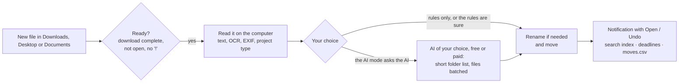

# User guide

How DeskTidy works, day by day. For the commands see [commands](commands.md), for the AI and what it sees
[AI and privacy](ai-and-privacy.md), for `rules.json` [configuration](configuration.md).

- [How it decides](#how-it-decides)
- [Pinned folders](#pinned-folders)
- [Smart renaming](#smart-renaming)
- [Organizing a crowded folder](#organizing-a-crowded-folder)
- [Tidy-up tools](#tidy-up-tools)
- [Find, remember, remind](#find-remember-remind)
- [Undo and history](#undo-and-history)
- [Part of your desktop](#part-of-your-desktop)
- [Works on](#works-on)
- [FAQ](#faq)

## How it decides

DeskTidy watches Downloads, the Desktop and Documents (you can change them). For each new item:



**It waits.** Downloads are handled 2 minutes after they finish, the Desktop and Documents after 10. Unfinished
downloads, open files, Office lock files (`~$...`), hidden and system files, shortcuts and launchers are skipped, and
so is anything whose name starts with `!`.

**The offline decision**, in this order:

1. **Pinned folders**: the name or the content talks about a folder you pinned.
2. **Name**: the words of a rule, also in plural or singular form or with one typo.
3. **Content**: strong words (`content_words`), topics (`topics`: at least two or three must appear) and recognised
   kinds (`photo`, `screenshot`, `code_python`, `project_kicad`...). A *generic* rule such as "notes" gives way to a
   confident content match.
4. **Similarity** with the files already in each folder.
5. **File type** (`.stl`, `.py`, `.exe`, `.dmg`, `.deb`...). Programs only ever go to the installers folder.

When the rules can't decide, the file goes to the *to-sort* folder (`Documents/00_Inbox/To_Sort` by default), unless
your AI mode asks the AI: see [AI and privacy](ai-and-privacy.md).

`desktidy explain <file>` (or right-click → DeskTidy → *Explain*) shows what DeskTidy understood of a file, which
folder it would choose and why, and whether the AI would see it. `desktidy preview` shows what it would do right now,
moving nothing.

**Folders by year.** A destination can contain `{YEAR}` and `{MONTH}`: `{DOCS}/Bills/{YEAR}` files a bill of March
2025 in `Bills/2025`, whenever it arrives. The date is the one of the document: read by the AI, else found in the
text ("Fattura n. 2231 del 30/09/2026", "Invoice date: 03/11/2025"), else the day the file was last changed.

## Pinned folders

Pinned folders are the places you want things to go: `Study`, `Work`, `Recipes`, a client's folder. New files that
talk about them, by name or by content, go there, and so do files that look like the ones already inside. DeskTidy
starts moving only after you pinned two (house rule 2).

```sh
desktidy pin recipes cooking pasta     # pin (a name creates it on the Desktop) with extra words
desktidy pinned                        # the list
desktidy pinned suggest                # folders you might want to pin
desktidy unpin recipes
```

When you create a folder on the Desktop, DeskTidy asks *Pin it?*. Right-click → DeskTidy → *Pin / unpin this
folder* does the same from the file manager.

## Smart renaming

| Before | After | Why |
|---|---|---|
| `scan0001.pdf` | `Invoice_2231_from_Northwind_Energy.pdf` | generic name, title from the first heading |
| `scan0001.pdf`, with the AI | `Fattura_2231_Acme_Srl_2026-09-30.pdf` | dated documents: kind, number, issuer, date |
| `Document1.docx` | `Lab_report_RC_filters.docx` | generic name, title from the document properties |
| `holiday_photos_list.txt` (an electricity bill) | `Electricity_bill_September.txt` | the name didn't match the content |
| `download (3).pdf` (no clear title) | `RC_Circuit_Resistance_Measurement.pdf` | name suggested by the AI in the same request |
| `!draft.docx`, `IMG_2034.jpg`, `my_thesis.pdf` | unchanged | `!` means hands off; photos and good names are kept |

`desktidy rename smart | generic | off` chooses how bold it is. In *always AI* mode the AI names every file the rules
would rename. A name you gave is replaced only when it is misleading or says nothing, and an AI name must be
meaningful and really different. The original name is always in the log, and `desktidy undo` brings it back.

## Organizing a crowded folder

Fifty files on the Desktop? `desktidy organize` lists the folders where loose items pile up (10 or more), among your
Desktop, Downloads, Documents, the to-sort pile and the pinned folders. It takes a moment and reads only names.

```sh
desktidy organize                # the crowded folders
desktidy organize desktop        # a plan for one (a name, a path, or its number in the list)
desktidy organize all            # a plan for every crowded folder
desktidy organize apply 2        # do group 2 of the plan, after a preview of every move
desktidy organize apply all --pin
desktidy organize undo           # put everything back
```

For each group the plan shows a title, the files, and where they go: a new folder (inside that folder; for Downloads
and the to-sort pile, in Documents) or a folder you already have. What your rules place with certainty goes where the
rules say. **Nothing moves until you apply it**, and `organize undo` puts everything back, even if you moved a few
files in the meantime (those stay where you put them). `desktidy undo <name>` restores a single file.

- **With the AI**, the groups are made by the AI from the name, the kind and the first words of each item.
- **Without the AI** (rules only, no key, or `--offline`), the offline engine groups the items that share names and
  words. Nothing leaves your computer, so private items are grouped too.

**Never moved**: names starting with `!`, shortcuts, pinned folders and the folders holding one, folders with a
Python environment inside, and the folders of programs (game saves, settings, code snippets: *Call of Duty*,
*Rockstar Games*, *Visual Studio 2022* in Documents...).

The same is in the browser: `desktidy editor` → *Organize*, and right-click on a folder, or on the empty space of a
folder or of the Desktop → DeskTidy → *Organize this folder*.

## Tidy-up tools

| Command | What it does |
|---|---|
| `desktidy groups` | groups of related files in the to-sort pile ("4 files about nucleo, gpio") with an existing folder that looks like them, or a new one; `groups apply 1 --pin` moves them and pins the folder |
| `desktidy organize` | crowded folders grouped into folders, by the AI or offline (see above) |
| `desktidy duplicates` | the same file, byte for byte, in two or more of your folders. One copy stays (the one in the best place, with the cleanest name), the others go to the Recycle Bin / Trash with `duplicates clean`, after you confirm. Hard links, files only in the cloud (OneDrive, iCloud), code projects and the folders of programs are never touched |
| `desktidy versions [folder]` | `Report.docx`, `Report_v2.docx`, `Report_final.docx`, `Report (1).docx`: the newest stays, the others go to `_old_versions` (`versions apply all`). Same name but different content (`Lesson_1`, `Lesson_2`) is never taken for a version |
| `desktidy installers` | setup files of programs that are already installed (`.exe`/`.msi`, `.dmg`/`.pkg`, `.deb`/`.rpm`), compared by name and version with the installed programs; newer installers and recent downloads are kept. `installers clean` sends them to the Trash after you confirm |
| `desktidy archive` | items untouched for 180 days on the Desktop and in the to-sort pile go to `Archive/<year>`, optionally zipped. Off by default: `archive on` |
| `desktidy import` | a memory card or USB stick with a `DCIM` folder: new photos and videos are **copied** (the card is untouched) to `Pictures/2026/2026-10` by the date they were taken. The service offers it with a notification when you plug the card in |

Every move made by these tools is logged and can be undone.

## Find, remember, remind

**Search by content.** Every document DeskTidy tidies goes into a local full-text index: name, title, a one-line
summary, key terms and up to 20,000 characters of text, OCR included. Documents already in your folders are indexed
in the background once a day (`desktidy find --rebuild` does it now). Accents, plurals and singulars don't matter.

```text
> desktidy find bolletta luce settembre
   1) Bolletta_Energia_Nord_Settembre.pdf  Documents/04_Personal/Bills
      Electricity bill for September, Energia Nord
      ...Totale da pagare 84,20 euro, da pagare entro il 30/10/2026...
```

**Deadlines.** Dates to pay or submit something are found in Italian and English documents ("da pagare entro il",
"scadenza", "entro e non oltre", "due date", "pay by", "expires on"...), with the amount when there is one. Reminders
arrive 7 days, 1 day and on the day, with *Open* and *Done* buttons. `desktidy deadlines` lists them,
`deadlines add 2026-10-30 Pay the rent` adds one by hand, and `deadlines ics --open` writes them to a calendar file
for Outlook, Google Calendar or Apple Calendar, with the same reminders (importing it again updates the events).

**Learning.** Every 30 minutes DeskTidy checks whether you moved a file it had placed. Two corrections towards the
same folder with words in common become a proposed rule. When the AI has put five files with words in common in the
same folder and you left them there for three days, that becomes a proposed rule too: once accepted, the next ones
are placed offline, without the AI. `desktidy learn` shows the proposals, `learn accept 1` adds one at the top of
your rules.

**Your week.** Once a week (Monday by default) a notification sums it up: files tidied and renamed, duplicates and
old installers cleaned, the deadlines of the coming week, what waits in the to-sort pile, the AI's work and spend.
`desktidy week` shows it any time; `week day friday` or `week off` changes it.

## Undo and history

Every move and rename is written to `moves.csv` in DeskTidy's data folder.

```sh
desktidy where invoice           # where did it go, and why
desktidy undo invoice            # put it back, with its old name
desktidy undo                    # choose among the latest moves
```

A file you put back is left alone from then on, until you change it. The *Undo* button of the notification does the
same, and `desktidy editor` → *History* lists the latest moves with an *Undo* button each. Changes to whole folders
(`organize apply`, `advice apply`) are undone together with `organize undo` / `advice undo`.

## Part of your desktop

- **Right-click menu** (installed by `desktidy install`; `desktidy explorer on | off`): on files *Tidy now*,
  *Explain*, *Hands off* (adds or removes the `!`); on folders *Pin / unpin*, *Explain*, *Organize this folder*,
  *Old versions here*, *Hands off*; on the empty space of a folder or of the Desktop *Organize*. Windows: in Explorer
  (on Windows 11 under *Show more options*). Linux: *Scripts → DeskTidy* in Files (Nautilus), and the DeskTidy
  entries of Nemo and Dolphin. Current user only, no administrator rights.
- **Notifications with buttons**: *Open* and *Undo* after a move, *Done* on a deadline, *Import* for a memory card,
  *Review* for a learned rule, *Show* for the weekly summary.
- **Tray icon** next to the clock (Windows): what DeskTidy did today, the latest moves, upcoming deadlines, search,
  pause, settings. `"tray": false` in `rules.json` turns it off.
- **In your browser** (`desktidy editor`): every setting, with validation before saving; the *Organize* tab (crowded
  folders, the plan with a preview, do it, undo) and the *History* tab (the latest moves, each with *Undo*). It runs
  on `127.0.0.1` only, with a random token, while the command runs.

## Works on

The engine, the commands, search, deadlines, the AI and every tidy-up tool are the same everywhere. What depends on
the system:

| | Windows 10 / 11 | macOS 11+ | Linux |
|---|---|---|---|
| Starts at sign-in | Task Scheduler | launchd agent | desktop autostart (or a systemd user service without a desktop) |
| User folders | the real ones, OneDrive included | `~/Documents`, `~/Movies`... | `user-dirs.dirs`: `Documenti`, `Scaricati`... too |
| OCR (scans, pictures) | Windows OCR, built in | Vision, built in | Tesseract, if installed |
| Recycle Bin / Trash | Recycle Bin | Trash (*Put Back* works) | freedesktop.org Trash (restorable) |
| Notifications | with buttons | yes; clickable with [terminal-notifier](https://github.com/julienXX/terminal-notifier) | with buttons (`notify-send`) |
| Right-click menu | Explorer | — (use `desktidy explain`) | Files (Nautilus), Nemo, Dolphin |
| Icon next to the clock | yes | — | — |
| Memory cards | drive letters | `/Volumes` | `/media`, `/run/media` |
| API keys | user environment | `keys.json`, readable only by you | `keys.json`, readable only by you |
| Without Python | the Windows build (a zip) | — | — |

## FAQ

**Will it touch files I'm working on?** No. It waits until a download is complete and the file has been still for a
while, skips open files, Office lock files, hidden and system files, and anything whose name starts with `!`.

**What if it gets one wrong?** *Undo* on the notification, `desktidy undo <name>` or *History* in the editor
restores it with its original name, and DeskTidy leaves it alone from then on. If you move it yourself instead,
DeskTidy learns from it.

**Can I limit how much it does?** Yes: `desktidy limit 30` (files per day), `desktidy ai max 20` (files the AI looks
at), a budget for paid services, `desktidy pause 1h` any time. Each limit can also be `unlimited`.

**Does it need the internet?** No. With *rules only* everything happens on your computer, and with Ollama even the AI
does. Search, deadlines, organize offline, duplicates, versions, installers, archive and import never need it.

**Is there a free AI option?** Yes: Groq, Gemini, Mistral and OpenRouter have free plans, and Ollama is free and
local. `desktidy ai provider` lists them with their limits and privacy terms; `desktidy ai test` compares them.

**macOS says Python can't access my folders.** Allow it when asked, or in System Settings › Privacy & Security ›
*Files and Folders* (or *Full Disk Access*). `desktidy status` and `desktidy log errors` say which folder is refused.

**Which Linux desktops?** Any that follows the freedesktop.org standards (GNOME, KDE Plasma, Cinnamon, Xfce,
MATE...). Without a desktop (a server), `desktidy install` uses a systemd user service.

**How do I remove it?** `desktidy uninstall` removes the start at sign-in, the command and the right-click menu (and
the program folder of the Windows build). Your files and DeskTidy's data folder stay where they are.
